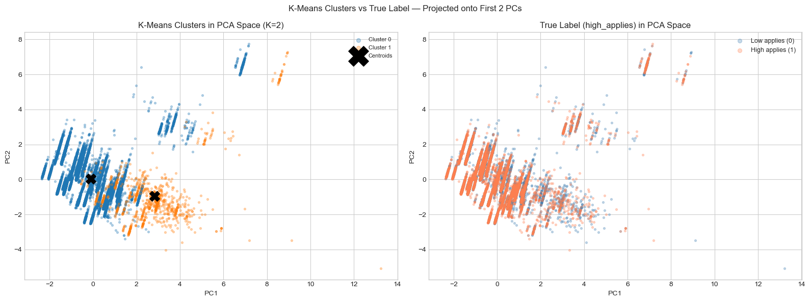

# What Makes a Job Posting Attract More Applicants?

**Predicting applicant volume from 124K LinkedIn job postings**
*Machine-learning course project · University of Pennsylvania · 2026*

**Question:** Can observable posting features (remote eligibility, salary disclosure, description length, listed skills, seniority, work type, experience level) predict whether a LinkedIn posting receives above-median applications?

**Data:** [`datastax/linkedin_job_listings`](https://huggingface.co/datasets/datastax/linkedin_job_listings) (Hugging Face). It has 123,849 postings, of which 23,320 have a recorded application count and are modeled.
**Label:** `high_applies` = 1 if `applies` ≥ median (52% / 48%).
**Stack:** Python · pandas · scikit-learn · matplotlib / seaborn · Jupyter

---

## Key findings
1. **Remote eligibility is the strongest single signal** (r = +0.20 with high applicant volume). Contract roles also draw more applicants (+0.12), while entry-level postings (−0.11) and longer descriptions (−0.09) draw fewer.
2. **Salary disclosure does not predict applicant volume** (r = −0.01), contrary to our hypothesis.
3. **The best models reach ~61% accuracy (Cohen's κ ≈ 0.22).** SVM, AdaBoost, logistic regression and a depth-limited decision tree are within 0.5 pp of each other. Unpruned trees and Random Forest overfit (~54%).
4. **Unsupervised structure is unrelated to the outcome.** An SVM on 2 principal components falls to chance (51%, κ ≈ 0). K-means (best K = 2) splits postings by salary disclosure, not by applicant volume.

**Takeaway:** posting metadata explains only a small share of applicant volume. Employer brand, job title, location and promotion are the likely drivers, and none of them are in these features.

## Model comparison
6 algorithms were each run under 8 evaluation schemes (two hold-out splits, 5-fold / 10-fold / stratified CV, a 5-feature subset, and two hyperparameter variants). The best configuration per algorithm:

| Algorithm | Best configuration | Accuracy | Cohen's κ |
|---|---|---|---|
| SVM (RBF) | 5-fold CV | **0.612** | 0.225 |
| AdaBoost | 10-fold CV | 0.611 | **0.226** |
| Logistic Regression | 10-fold stratified CV | 0.610 | 0.224 |
| Decision Tree | max_depth = 5 | 0.607 | 0.222 |
| Naive Bayes | 10-fold CV, top-5 features | 0.593 | 0.179 |
| Random Forest | 10-fold CV, top-5 features | 0.549 | 0.096 |

Limiting tree depth was the single largest improvement (Decision Tree went from 53% to 61%). With a weak signal (no feature has |r| > 0.2), unconstrained trees memorize noise.

## Unsupervised analysis
- **PCA:** variance is spread evenly. PC1 explains 10.5%, and 10 components explain 76%. PC1 is an *early-career vs. mid-senior* axis. The most predictive feature, `is_remote`, barely loads on PC1 or PC2.
- **K-means:** best K = 2 (silhouette 0.49). The clusters are 22,381 vs. 939 postings, and the split is defined almost entirely by salary disclosure. The high-applies share is 52% vs. 49%.



## Features (16)
`med_salary`, `has_salary`, `is_remote`, `desc_word_count`, `skills_count`, `is_senior` (from title keywords), 6 work-type dummies, and 4 experience-level dummies. All are standardized before modeling.

## Run
```bash
pip install pandas numpy scikit-learn matplotlib seaborn huggingface_hub jupyter
jupyter notebook notebooks/linkedin_applicant_volume.ipynb   # downloads the data from Hugging Face
```
A full run takes about 45 minutes on a laptop, mostly the SVM cross-validation.

## Limitations
Only 19% of postings report `applies`, so the modeled sample may not represent all postings. Applicant counts also depend on how long a posting has been live, which is not controlled for. All results are associations.
